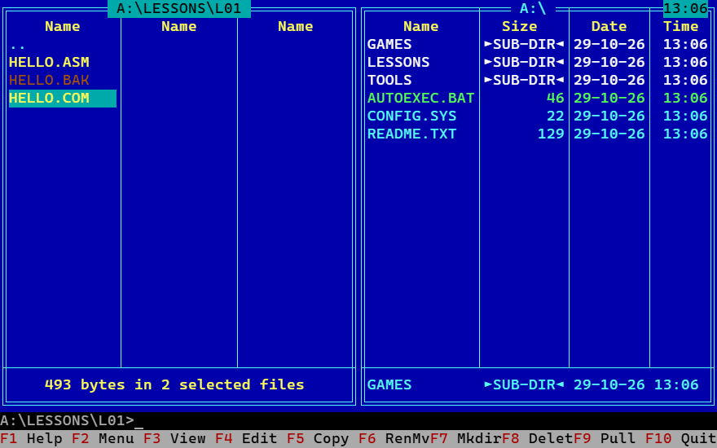
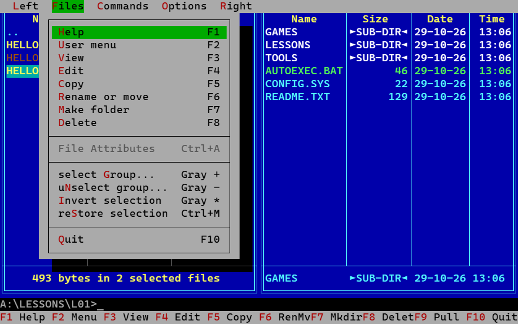
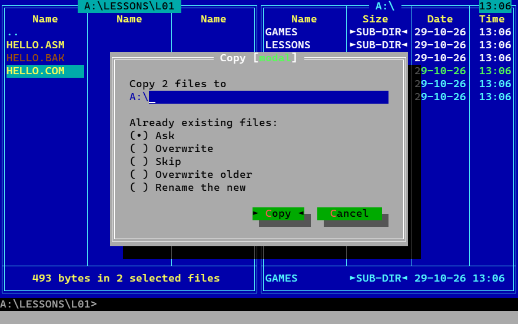
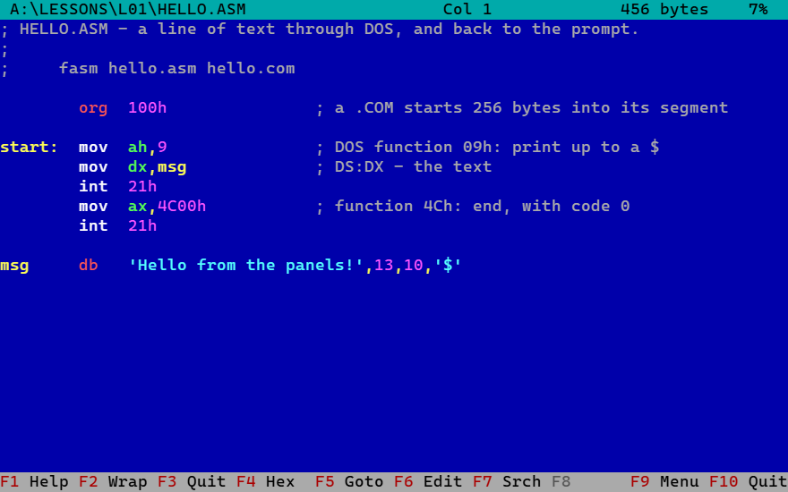
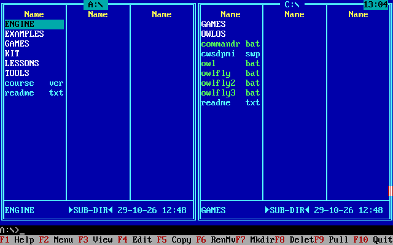

# Kirin Commander

**One file manager in Rust, from DOS to the browser.** The same source, the
same panels, the same keys - built four ways:

| | |
|---|---|
| **DOS** | a 32-bit binary under DPMI on a 386, writing straight into text memory at B800, its files through INT 21h |
| **Windows** | a console program |
| **Linux** | a terminal program |
| **A browser** | WebAssembly on a canvas, its drives the browser's own storage |

Not four ports: one commander (`kc/`, `no_std`, so it fits DOS), and for
each place a small host that gives it keys, a screen and files. A fix
made once is made everywhere, and a test of `kc/` is a test of all four.

It is a two-panel file manager in the line of Norton Commander, Volkov
Commander and Far Manager - the "orthodox file manager".

It is built on [OWLOSUI](https://github.com/KirinDenis/OWLOSUI), a text-mode
user interface toolkit with one core written in Rust, drawn the same way on
DOS (through its resident at INT 60h), in a native window or a terminal,
and on a canvas in a browser (WebAssembly). OWLOSUI draws every cell; Kirin
Commander says what the panels hold and what the keys do.

**Try it in the browser:** [kirindenis.github.io/Kirin_Commander](https://kirindenis.github.io/Kirin_Commander/).
There A: is a read-only sample disk, C: a disk in memory, and D: a folder
of your browser's storage that is still there tomorrow. F1 shows the
keys, F9 the menu.

**Download:** [the latest release](https://github.com/KirinDenis/Kirin_Commander/releases/latest) -
`kc-dos.zip` (KC.COM, KC.BIN and CWSDPMI for DOS, a 386 or later) and
`kc-windows-x64.zip` (`kc.exe`, in a console window).

| | |
|---|---|
|  |  |
| The F9 menu: every item shows its key | F5: what to do with files already there is asked first |
|  |  |
| F3: the viewer, an assembly source coloured by its language | On DOS: the same program, drawn into B800 (WIRE CITY's DOS PC) |

The screens above are the browser build, which draws the cells the DOS
build puts in text memory; the last one is DOS itself.

## Status

Being built, the documents first: they say what the program is, to the
key and to the cell, and the program is tested against them - the main
screen, the drive menu and the F9 menu are compared with the documents'
screens cell for cell (`kc/tests/screens.rs`), so the two cannot drift.

Working now, on DOS, in a desktop terminal and in a browser:

- the two panels in one screen: Brief (three columns of 8.3 names) and
  Full, Medium, Wide; sorting (Ctrl+F3..F7); every cursor rule of
  [02-panels.md](docs/02-panels.md) 2.4, each with its test;
- selection: Insert, Shift+arrows, Gray + - * with masks, Ctrl+M;
  quick search (Alt+letter); the drive menu (Alt+F1 / Alt+F2); filter
  (Ctrl+F); hidden files (Ctrl+H); Ctrl+O, Ctrl+U, Ctrl+F1/F2, Ctrl+B;
- copy, move, rename, delete, make folder - a step at a time, with the
  overwrite question (Overwrite, All, Skip, Skip all, Append, Rename),
  read-only files asked about, and every error as Retry / Skip / Skip all
  / Cancel; a stopped copy leaves no short file, a move across drives
  deletes a source only once its copy is whole;
- the command line (`cd`, `C:`, Ctrl+Enter, history), run through
  COMMAND.COM on DOS and the system's shell on a desktop; on DOS, Ctrl+O
  shows the screen the program left;
- the viewer (F3) and the editor (F4, Shift+F4): the whole screen, no
  buttons, the menu hidden until F9, OWLOSUI's text view under it;
- the F9 menu - every item does what it says ([04-menus.md](docs/04-menus.md)):
  Help (F1), the user menu (F2, `KC.MNU`) and the extension table
  (Enter, `KC.EXT`), File Attributes, Find file, History, Folder Tree,
  Volume label, System Info, Folder shortcuts, and Languages from
  `KC*.LNG` files; the Info, Tree and Quick view panels;
- the key bar as `F1 Help`, ten even cells, its Shift / Ctrl / Alt rows
  while one is held;
- the Options dialogs - Configuration, Panel settings, Colours,
  Confirmations, Viewer and editor - with Menu bar always visible, and
  Save setup (Shift+F9) into `KC.INI`, read at the next start
  ([04-menus.md](docs/04-menus.md));
- the drive menu on DOS with each disk's size and free space;
- in a browser (`web/`): the same program as WebAssembly on OWLOSUI's
  canvas, over a page's drives - a browser's storage (OPFS) or any
  source with WIRE CITY's `Drive` calls. The command line goes to the
  page's `run`; the test page has none, WIRE CITY's console is next.

On DOS it is already WIRE CITY's commander: the course page and the site
start into it, with `/STEP` so a game run from it has all of DOS's memory
(docs/07 7.2).

Not yet: the browser build inside WIRE CITY (its drive table, its console
as the terminal, docs/07 7.4); a translation (the language files work,
none is written); the key bar's rows while Shift, Ctrl or Alt is held on
a desktop; INT 24h on DOS. [09-decisions.md](docs/09-decisions.md) keeps the list.

## Building

| | |
|---|---|
| Tests | `cargo test` |
| A terminal (Windows, Linux) | `cargo run -p kc-term` - and `kc --shot "Down F4 F9"` prints a frame after those keys, for a test with no person |
| DOS | `dos\build.cmd` (Rust nightly with `rust-src`, FASM), then `RUN` inside DOS, or `dos\RUNWIN.BAT` from Windows with DOSBox-X. `RUNWIN KEYS` types keys at it and keeps a frame after each in `SHOTS.TXT` |
| A browser | `web\build.cmd` (the `wasm32-unknown-unknown` target, and Binaryen's `wasm-opt` for asyncify) makes `web\kc.wasm`; serve `web/` and open `index.html`: A: read-only and C: in memory, D: a folder of the browser's storage. `kc.keys("Down F5 Enter")` and `kc.text()` in the page's console are a test's hands and eyes. `web\pull-owlosui.cmd` copies the OWLOSUI web parts it draws with |

The parts: `kc/` is the commander itself, the same everywhere (`no_std`
for DOS); `term/` the terminal host; `web/` the browser host - `kc.wasm`, and `kc.js`, which gives it the page's drives and draws its frames; `dos/` the DOS host - `KC.COM`, the
loader from OWLOSUI's `lib/dos`, and `KC.BIN`, the commander, in extended
memory under DPMI (CWSDPMI, beside it).

OWLOSUI is taken as a path dependency, `../OWLOSUI`, beside this
repository, until the OWLOSUI changes the commander needs are committed
there; then a git dependency pinned to that commit (D12).

## The documents

| | |
|---|---|
| [docs/01-screen.md](docs/01-screen.md) | The screen: panels, frames, the mini status, the command line, the key bar, the menu bar, colours |
| [docs/02-panels.md](docs/02-panels.md) | A panel: view modes, names, sorting, the cursor, selection and masks, quick search, the drive menu |
| [docs/03-keys.md](docs/03-keys.md) | Every key, in panels, on the command line, in dialogs |
| [docs/04-menus.md](docs/04-menus.md) | The pull-down menu (F9), item by item |
| [docs/05-file-operations.md](docs/05-file-operations.md) | Copy, move, rename, delete, make folder: dialogs, questions, progress, errors |
| [docs/06-file-systems.md](docs/06-file-systems.md) | One file-system interface over DOS INT 21h, Win32, POSIX and the browser's storage |
| [docs/07-command-line.md](docs/07-command-line.md) | The command line, the terminal behind the panels, the browser console |
| [docs/08-viewer-editor.md](docs/08-viewer-editor.md) | The viewer (F3) and the editor (F4) |
| [docs/09-decisions.md](docs/09-decisions.md) | Where the references disagree, and what is chosen; what OWLOSUI must gain |
| [docs/sources.md](docs/sources.md) | Where each fact comes from |

## Licence

MIT, as OWLOSUI. `dos/CWSDPMI.EXE` is CWSDPMI, the DPMI host by Charles
W. Sandmann, redistributed unchanged under its own terms
(`dos/cwsdpmi.doc`).
